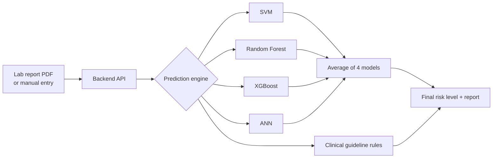

<div align="center">

# 🩺 Smart Disease Prediction System

**Upload a lab report or enter your values, and get an easy-to-understand health risk screening in English, Telugu or Hindi.**


</div>

> ⚠️ **Screening aid only, not a medical diagnosis.** Always confirm results with a qualified doctor.

---

## ✨ Features

- **Two ways to start**: type lab values by hand or upload a PDF lab report (values are read automatically).
- **Multi-disease screening**: 6 diseases predicted by machine learning, plus many more through clinical guideline rules.
- **4 ML models working together**: SVM, Random Forest, XGBoost and ANN, averaged into one result.
- **Patient-friendly results**: risk level, key signals, simple explanation and recommendations, with no technical jargon.
- **Downloadable report** in English, Telugu or Hindi.
- **"About the Model" page**: accuracy and how the result was prepared, kept separate so results stay calm and clear.
- **Accounts and history**: sign up, log in and revisit past reports.

## 🧠 How it works



1. Values come from a PDF or the entry form.
2. Four trained models each estimate the risk. Their answers are averaged (soft voting).
3. Clinical guideline rules run alongside, and the **higher** of the two risk levels is shown.
4. Diseases without a suitable training dataset use guideline rules only.

### Machine-learning performance

Cross-validated AUC (5-fold, repeated 5 times, held-out data only). 1.00 is perfect, 0.50 is chance.

| Disease | Dataset rows | SVM | Random Forest | XGBoost | ANN | **Ensemble** |
|---|---:|---:|---:|---:|---:|---:|
| Type 2 Diabetes | 724 | 0.83 | 0.83 | 0.83 | 0.83 | **0.84** |
| Coronary Heart Disease (10-yr) | 3,658 | 0.73 | 0.72 | 0.72 | 0.73 | **0.73** |
| Liver Disease | 579 | 0.75 | 0.74 | 0.73 | 0.73 | **0.74** |
| Chronic Kidney Disease | 400 | 0.97 | 1.00 | 1.00 | 0.97 | **0.99** |
| Stroke Risk | 3,255 | 0.82 | 0.80 | 0.80 | 0.80 | **0.81** |
| Hypothyroidism | 2,291 | 0.97 | 0.97 | 0.97 | 0.97 | **0.97** |

Datasets: Pima Indians Diabetes, Framingham Heart Study, Indian Liver Patient (ILPD), UCI Chronic Kidney Disease,
Kaggle Stroke Prediction, UCI Thyroid. Details and limitations are on the in-app **About the Model** page.

## 🗂️ Project structure

```
├── frontend/     React + Vite + Tailwind web app
├── backend/      Express API: login, PDF reading, prediction engine, reports
├── ml/           Machine learning: training script, trained models, tests, sample reports
├── package.json  Handy scripts for running everything from the root
└── README.md
```

## 🚀 Quick start

**Requirements:** Node.js 20 or newer. Python 3.10+ is needed only if you want to retrain the models.

```bash
# 1. Install everything
npm run install:all

# 2. Start the backend  (http://localhost:3000)
npm run dev:backend

# 3. In a second terminal, start the frontend  (http://localhost:5173)
npm run dev:frontend
```

Open **http://localhost:5173** in your browser.

### Optional settings

Copy `backend/.env.example` to `backend/.env`:

| Variable | Purpose |
|---|---|
| `GEMINI_API_KEY` | Improves reading of PDF lab reports (optional) |
| `JWT_SECRET` | Secret for login tokens. Set your own value in production |
| `PORT` | Backend port (default 3000) |

### Production build

```bash
npm run build     # builds frontend/dist
npm start         # backend serves the built frontend on http://localhost:3000
```

### Try it with sample reports

`ml/sample_reports/` has ready-made PDF lab reports (one healthy and one for each ML-backed disease). Upload any of them to see how the app works.

## 🔁 Retraining and testing the models

```bash
pip install -r ml/requirements.txt
python3 ml/train_models.py        # downloads datasets, trains all 4 models, rewrites ml/models/*.json (~7 min)
npm run test:ml                   # checks the TypeScript runtime matches Python + end-to-end scenarios
```

## 🔌 API overview

| Method | Endpoint | Description |
|---|---|---|
| POST | `/api/auth/register`, `/api/auth/login` | Create account, log in |
| GET / PUT | `/api/auth/me`, `/api/auth/profile` | View or update profile |
| POST | `/api/predict/manual` | Predict from entered values |
| POST | `/api/predict/upload` | Predict from a PDF lab report |
| GET / DELETE | `/api/predictions`, `/api/predictions/:id` | History |
| GET | `/api/reports/:id/download` | Download the report |
| GET | `/api/model-info` | Model accuracy details (used by "About the Model") |

## 🛠️ Tech stack

**Frontend:** React 19, Vite, Tailwind CSS · **Backend:** Node.js, Express, TypeScript · **ML:** scikit-learn, XGBoost, pandas
(models are exported to JSON and run directly in TypeScript, so the server needs no Python).

## ⚖️ Limitations

- Probabilities are relative to each training dataset's disease prevalence, not the general population.
- The kidney dataset is small (400 rows) and almost perfectly separable, so its score is optimistic for early-stage disease.
- Datasets come from specific populations (for example, the heart model uses a US cohort).
- Diseases without a trained model use hand-written guideline thresholds, which are not trained models.

---

<div align="center">Made for early health awareness. Not a replacement for professional medical advice.</div>
